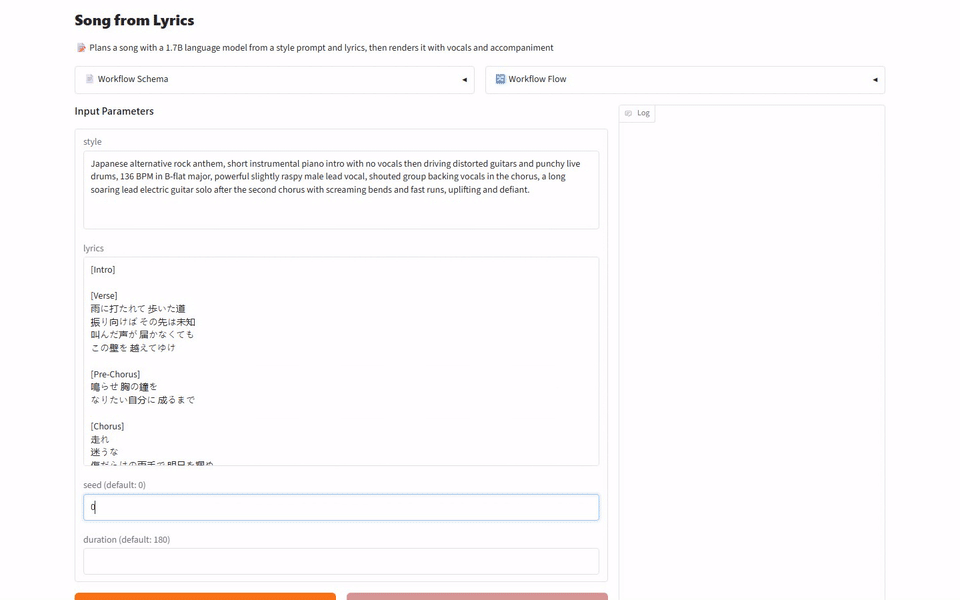
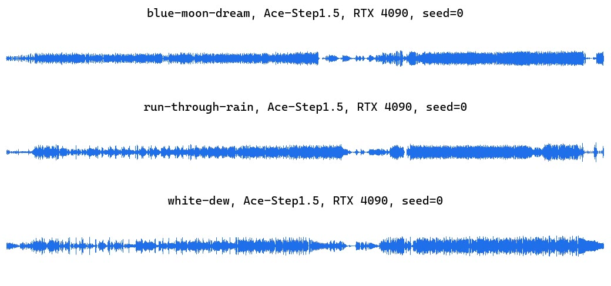
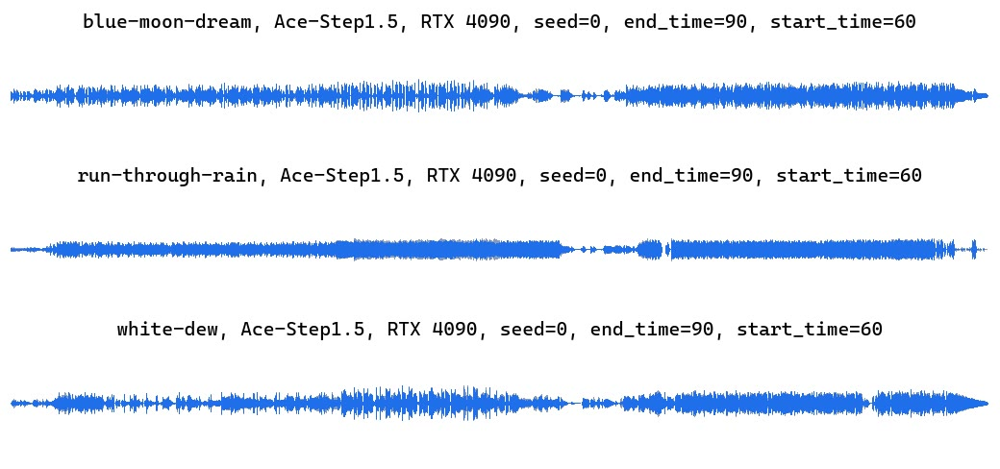
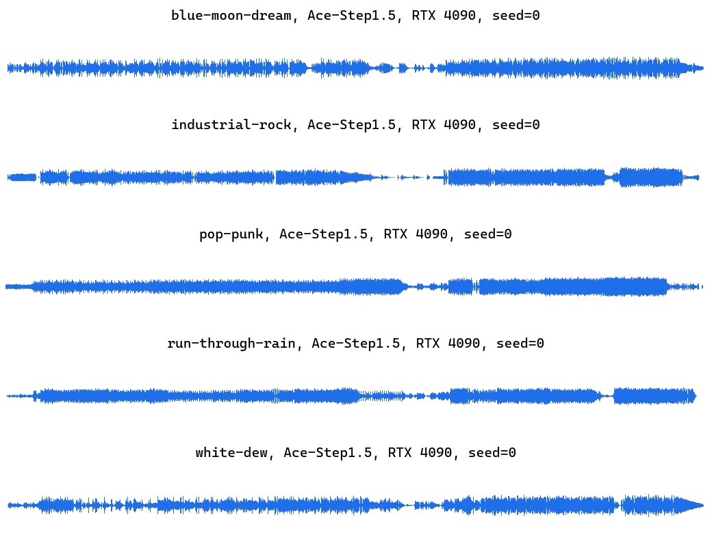

[English](README.md) · [한국어](README.ko.md) · [中文](README.zh.md)

# music-generation-ace-step

스타일 문장과 가사를 받아 보컬과 반주가 든 노래를 만들고, 기존 곡을 다른 장르로 커버하거나 고른 구간을 다시 만듭니다.



## 빠른 시작

[model-compose](https://github.com/hanyeol/model-compose) 0.4.124 이상이 필요합니다.

[uv](https://docs.astral.sh/uv/)로 설치:

```bash
uv pip install model-compose
```

또는 pip로 설치:

```bash
pip install model-compose
```

이 저장소 클론:

```bash
git clone https://github.com/MindrLabs/music-generation-ace-step
cd music-generation-ace-step
```

실행:

```bash
model-compose up
```

API 주소는 http://localhost:8080/api, Gradio UI 주소는 http://localhost:8081 입니다.

## 요약

RTX 4090은 노래 한 곡을 중앙값 3.64초 걸려 만들었습니다.

| 기기 | 상태 | 설정 | RTF | 최대 메모리 (MiB) |
| :---: | --- | --- | --- | --- |
| MacBook M1 16GB | 측정 | generate | 1.02 | 28900 (footprint) |
| DGX Spark | 측정 | generate | 0.045 | 16319 (VRAM) |
| RTX 4090 | 측정 | generate | 0.02 | 12306 (VRAM) |

## 측정 환경

model-compose 0.4.123 버전으로 측정했습니다. 통계는 95% 구간을 쓰고 1.05배 미만 속도 차이는 판정하지 않습니다.

| 설정 | 입력 | 가중치 |
| :---: | --- | --- |
| generate | 입력 5개 × 반복 3회 | [ACE-Step/Ace-Step1.5](https://huggingface.co/ACE-Step/Ace-Step1.5) |
| cover | 입력 3개 × 반복 3회 | [ACE-Step/Ace-Step1.5](https://huggingface.co/ACE-Step/Ace-Step1.5) |
| repaint | 입력 3개 × 반복 3회 | [ACE-Step/Ace-Step1.5](https://huggingface.co/ACE-Step/Ace-Step1.5) |

## 결과

- DGX Spark는 한 곡에 중앙값 8.12초 걸렸고 MacBook M1 16GB는 184초 걸려 노래 길이와 비슷한 시간이 들었습니다.
- 입력 곡 수가 적어 기기 사이 속도와 품질 차이는 통계로 확인하지 못했습니다.

### 기존 곡 커버

원곡 오디오와 새 스타일 문장, 가사를 넣으면 같은 곡을 다른 장르와 보컬로 다시 부릅니다.

| 주장 | 확인 방법 | 통과 |
| :---: | --- | --- |
| 기존 녹음의 커버가 곡은 그대로 두고 새 스타일을 입습니다. | 사람 판정 | ✓ |

MacBook M1 16GB, DGX Spark, RTX 4090 기기에서 측정했습니다. RTF는 처리에 걸린 시간을 오디오나 영상 길이로 나눈 값이라 낮을수록 빠릅니다. 각 칸은 측정한 호출의 중앙값이며 다른 GPU 작업 중에 한 호출은 빼고 계산합니다.

| 기기 | RTF | 호출당 초 | 최대 메모리 (MiB) | inner_silence_ratio | leading_silence_sec | longest_gap_sec | silence_ratio | speech_sec | trailing_silence_sec |
| :---: | --- | --- | --- | --- | --- | --- | --- | --- | --- |
| MacBook M1 16GB | 1 | 180 | 29926 (footprint) | 0.447 | 4.78 | 11.3 | 0.473 | 94.9 | 3.48 |
| DGX Spark | 0.079 | 14.2 | 17721 (VRAM) | 0.45 | 3.52 | 9.58 | 0.469 | 95.6 | 3.14 |
| RTX 4090 | 0.028 | 4.97 | 16428 (VRAM) | 0.468 | 4.88 | 9.91 | 0.497 | 90.4 | 4.79 |

[](https://mindrlabs.github.io/music-generation-ace-step/samples/#cover-v2.nvidia-rtx-4090-24gb)

- blue-moon-dream, Ace-Step1.5, RTX 4090, seed=0: [lyrics](docs/inputs/cover-v2/blue-moon-dream/lyrics.txt) · [source.wav](docs/inputs/cover-v2/blue-moon-dream/source.wav) · [출력](docs/samples/cover-v2.nvidia-rtx-4090-24gb.c00.blue-moon-dream.r1.wav)
  > Japanese alternative rock anthem, short instrumental piano intro with no vocals then driving distorted guitars and punchy live drums, 136 BPM in B-flat major, powerful slightly raspy male lead vocal, shouted group backing vocals in the chorus, a long soaring lead electric guitar solo after the second chorus with screaming bends and fast runs, uplifting and defiant.
- run-through-rain, Ace-Step1.5, RTX 4090, seed=0: [lyrics](docs/inputs/cover-v2/run-through-rain/lyrics.txt) · [source.wav](docs/inputs/cover-v2/run-through-rain/source.wav) · [출력](docs/samples/cover-v2.nvidia-rtx-4090-24gb.c00.run-through-rain.r1.wav)
  > Mandarin pop ballad, soft electric piano and warm synth pads over a light electronic pop beat, 98 BPM in G major, clear and sweet female lead vocal, gentle rounded bass, an instrumental intro with no vocals, nostalgic autumn mood.
- white-dew, Ace-Step1.5, RTX 4090, seed=0: [lyrics](docs/inputs/cover-v2/white-dew/lyrics.txt) · [source.wav](docs/inputs/cover-v2/white-dew/source.wav) · [출력](docs/samples/cover-v2.nvidia-rtx-4090-24gb.c00.white-dew.r1.wav)
  > K-pop girl group trip hop in C major at 76 BPM half-time, driven by a deep, warm sub bass and a heavy, punchy breakbeat with crisp snare and booming kick up front in the mix, soft piano chords and hazy pads underneath, airy layered female vocals with close harmonies, wide stereo panning, a key change lifting into the second verse, an instrumental intro with no vocals, dreamy and hypnotic.

### 구간 다시 만들기

원곡 오디오와 다시 만들 구간의 시작·끝 초, 스타일 문장을 넣으면 그 구간을 새로 만듭니다.

| 주장 | 확인 방법 | 통과 |
| :---: | --- | --- |
| 고른 구간만 다시 만들고 나머지 녹음은 그대로 둡니다. | 사람 판정 | ✗ |

MacBook M1 16GB, DGX Spark, RTX 4090 기기에서 측정했습니다. RTF는 처리에 걸린 시간을 오디오나 영상 길이로 나눈 값이라 낮을수록 빠릅니다. 각 칸은 측정한 호출의 중앙값이며 다른 GPU 작업 중에 한 호출은 빼고 계산합니다.

| 기기 | RTF | 호출당 초 | 최대 메모리 (MiB) | inner_silence_ratio | leading_silence_sec | longest_gap_sec | silence_ratio | speech_sec | trailing_silence_sec |
| :---: | --- | --- | --- | --- | --- | --- | --- | --- | --- |
| MacBook M1 16GB | 1 | 181 | 29927 (footprint) | 0.561 | 5.96 | 13.2 | 0.588 | 74.2 | 4.78 |
| DGX Spark | 0.076 | 13.8 | 17669 (VRAM) | 0.569 | 6.04 | 15.3 | 0.596 | 72.8 | 4.89 |
| RTX 4090 | 0.028 | 5.12 | 16378 (VRAM) | 0.551 | 6.04 | 13.2 | 0.577 | 76.1 | 4.41 |

[](https://mindrlabs.github.io/music-generation-ace-step/samples/#repaint-v2.nvidia-rtx-4090-24gb)

- blue-moon-dream, Ace-Step1.5, RTX 4090, seed=0, end\_time=90, start\_time=60: [lyrics](docs/inputs/repaint-v2/blue-moon-dream/lyrics.txt) · [source.wav](docs/inputs/repaint-v2/blue-moon-dream/source.wav) · [출력](docs/samples/repaint-v2.nvidia-rtx-4090-24gb.c00.blue-moon-dream.r1.wav)
  > K-pop girl group trip hop in C major at 76 BPM half-time, driven by a deep, warm sub bass and a heavy, punchy breakbeat with crisp snare and booming kick up front in the mix, soft piano chords and hazy pads underneath, airy layered female vocals with close harmonies, wide stereo panning, a key change lifting into the second verse, an instrumental intro with no vocals, dreamy and hypnotic.
- run-through-rain, Ace-Step1.5, RTX 4090, seed=0, end\_time=90, start\_time=60: [lyrics](docs/inputs/repaint-v2/run-through-rain/lyrics.txt) · [source.wav](docs/inputs/repaint-v2/run-through-rain/source.wav) · [출력](docs/samples/repaint-v2.nvidia-rtx-4090-24gb.c00.run-through-rain.r1.wav)
  > Japanese alternative rock anthem, short instrumental piano intro with no vocals then driving distorted guitars and punchy live drums, 136 BPM in B-flat major, powerful slightly raspy male lead vocal, shouted group backing vocals in the chorus, a long soaring lead electric guitar solo after the second chorus with screaming bends and fast runs, uplifting and defiant.
- white-dew, Ace-Step1.5, RTX 4090, seed=0, end\_time=90, start\_time=60: [lyrics](docs/inputs/repaint-v2/white-dew/lyrics.txt) · [source.wav](docs/inputs/repaint-v2/white-dew/source.wav) · [출력](docs/samples/repaint-v2.nvidia-rtx-4090-24gb.c00.white-dew.r1.wav)
  > Mandarin pop ballad, soft electric piano and warm synth pads over a light electronic pop beat, 98 BPM in G major, clear and sweet female lead vocal, gentle rounded bass, an instrumental intro with no vocals, nostalgic autumn mood.

### 가사로 노래 만들기

장르·악기·보컬을 적은 스타일 문장과 구간 표시가 붙은 가사를 넣으면 그 가사를 부르는 데모 곡이 나옵니다.

| 주장 | 확인 방법 | 통과 |
| :---: | --- | --- |
| 곡이 스타일 문장이 말한 장르, 악기, 음색을 따릅니다. | 사람 판정 | ✓ |
| 가사를 쓰인 언어로, 구간 구조를 따라 부릅니다. | 사람 판정 | ✓ |

MacBook M1 16GB, DGX Spark, RTX 4090 기기에서 측정했습니다. RTF는 처리에 걸린 시간을 오디오나 영상 길이로 나눈 값이라 낮을수록 빠릅니다. 각 칸은 측정한 호출의 중앙값이며 다른 GPU 작업 중에 한 호출은 빼고 계산합니다.

| 기기 | RTF | 호출당 초 | 최대 메모리 (MiB) | aes_ce | aes_cu | aes_pc | aes_pq | inner_silence_ratio | leading_silence_sec | longest_gap_sec | silence_ratio | songeval_clarity | songeval_coherence | songeval_memorability | songeval_musicality | songeval_naturalness | speech_sec | trailing_silence_sec |
| :---: | --- | --- | --- | --- | --- | --- | --- | --- | --- | --- | --- | --- | --- | --- | --- | --- | --- | --- |
| MacBook M1 16GB | 1.02 | 184 | 28900 (footprint) | 7.66 | 7.94 | 6.32 | 8.3 | 0.387 | 1.97 | 7.15 | 0.414 | 4.21 | 4.35 | 4.35 | 4.23 | 4.18 | 106 | 6.6 |
| DGX Spark | 0.045 | 8.12 | 16319 (VRAM) | 7.63 | 7.91 | 6.41 | 8.27 | 0.34 | 3.4 | 8.29 | 0.367 | 4.22 | 4.4 | 4.4 | 4.25 | 4.21 | 114 | 3.77 |
| RTX 4090 | 0.02 | 3.64 | 12306 (VRAM) | 7.64 | 7.87 | 6.38 | 8.26 | 0.438 | 4.61 | 8.74 | 0.472 | 4.2 | 4.34 | 4.37 | 4.24 | 4.16 | 95 | 7.24 |

[](https://mindrlabs.github.io/music-generation-ace-step/samples/#generate-v2.nvidia-rtx-4090-24gb)

- blue-moon-dream, Ace-Step1.5, RTX 4090, seed=0: [lyrics](docs/inputs/generate-v2/blue-moon-dream/lyrics.txt) · [출력](docs/samples/generate-v2.nvidia-rtx-4090-24gb.c00.blue-moon-dream.r1.wav)
  > K-pop girl group trip hop in C major at 76 BPM half-time, driven by a deep, warm sub bass and a heavy, punchy breakbeat with crisp snare and booming kick up front in the mix, soft piano chords and hazy pads underneath, airy layered female vocals with close harmonies, wide stereo panning, a key change lifting into the second verse, an instrumental intro with no vocals, dreamy and hypnotic.
- industrial-rock, Ace-Step1.5, RTX 4090, seed=0: [lyrics](docs/inputs/generate-v2/industrial-rock/lyrics.txt) · [출력](docs/samples/generate-v2.nvidia-rtx-4090-24gb.c00.industrial-rock.r1.wav)
  > Dark industrial pop rock with grunge grit, a heavy distorted bass riff, stomping drums with hard claps, gritty fuzz guitars, a shouted chorus, male lead vocal with gang vocals, 139 BPM in D-sharp minor, an instrumental bass intro with no vocals, menacing and intense.
- pop-punk, Ace-Step1.5, RTX 4090, seed=0: [lyrics](docs/inputs/generate-v2/pop-punk/lyrics.txt) · [출력](docs/samples/generate-v2.nvidia-rtx-4090-24gb.c00.pop-punk.r1.wav)
  > Early-2000s pop-punk, crunchy power-chord electric guitars, palm-muted verses bursting into a big open chorus, driving punk drums and bass, 150 BPM in D major, bratty and confident female lead vocal, an instrumental guitar intro with no vocals, rebellious teenage energy.
- run-through-rain, Ace-Step1.5, RTX 4090, seed=0: [lyrics](docs/inputs/generate-v2/run-through-rain/lyrics.txt) · [출력](docs/samples/generate-v2.nvidia-rtx-4090-24gb.c00.run-through-rain.r1.wav)
  > Japanese alternative rock anthem, short instrumental piano intro with no vocals then driving distorted guitars and punchy live drums, 136 BPM in B-flat major, powerful slightly raspy male lead vocal, shouted group backing vocals in the chorus, a long soaring lead electric guitar solo after the second chorus with screaming bends and fast runs, uplifting and defiant.
- white-dew, Ace-Step1.5, RTX 4090, seed=0: [lyrics](docs/inputs/generate-v2/white-dew/lyrics.txt) · [출력](docs/samples/generate-v2.nvidia-rtx-4090-24gb.c00.white-dew.r1.wav)
  > Mandarin pop ballad, soft electric piano and warm synth pads over a light electronic pop beat, 98 BPM in G major, clear and sweet female lead vocal, gentle rounded bass, an instrumental intro with no vocals, nostalgic autumn mood.

## 추천

- 여러 스타일을 빠르게 들어 보려면 한 곡에 몇 초면 끝나는 RTX 4090이나 DGX Spark에서 돌리는 편이 낫습니다.
- 구간 다시 만들기는 고른 구간 앞부분까지 원곡과 달라졌으니, 쓰기 전에 곡 전체를 들어 보고 확인하는 편이 낫습니다.

## 한계와 측정하지 않은 것

- 구간 다시 만들기는 고른 구간을 새로 만들었지만, 사람이 들어 보니 그 앞부분도 원곡과 똑같지 않았고 구간 경계가 매끄럽게 이어지지 않았습니다.

### 측정 조건

| 항목 | 내용 |
| :---: | --- |
| 제약 | turbo 체크포인트를 추론 8단계로만 쟀고 base와 SFT 체크포인트는 재지 않았습니다. |
| 제약 | Apple M1에서는 기본 한도로 메모리가 부족해 PYTORCH_MPS_HIGH_WATERMARK_RATIO=0.0으로 MPS 메모리 한도를 풀었습니다. |
| 제약 | DGX Spark에서는 생각용 LM이 flash_attn 없이, CUDA 그래프를 끈 채 돌았습니다. |

### 측정하지 못한 것

| 대상 | 항목 | 이유 |
| :---: | --- | --- |
| MacBook M1 16GB / DGX Spark | RTF | 두 기기 모두 다른 GPU 작업 없이 잰 입력이 5개뿐이라 최소 20개가 필요합니다. |
| MacBook M1 16GB / RTX 4090 | RTF | 두 기기 모두 다른 GPU 작업 없이 잰 입력이 5개뿐이라 최소 20개가 필요합니다. |
| DGX Spark / RTX 4090 | RTF | 두 기기 모두 다른 GPU 작업 없이 잰 입력이 5개뿐이라 최소 20개가 필요합니다. |
| MacBook M1 16GB / DGX Spark | aes_ce | 두 기기 모두 채점한 입력이 5개뿐이라 최소 20개가 필요합니다. |
| MacBook M1 16GB / RTX 4090 | aes_ce | 두 기기 모두 채점한 입력이 5개뿐이라 최소 20개가 필요합니다. |
| DGX Spark / RTX 4090 | aes_ce | 두 기기 모두 채점한 입력이 5개뿐이라 최소 20개가 필요합니다. |
| MacBook M1 16GB / DGX Spark | aes_cu | 두 기기 모두 채점한 입력이 5개뿐이라 최소 20개가 필요합니다. |
| MacBook M1 16GB / RTX 4090 | aes_cu | 두 기기 모두 채점한 입력이 5개뿐이라 최소 20개가 필요합니다. |
| DGX Spark / RTX 4090 | aes_cu | 두 기기 모두 채점한 입력이 5개뿐이라 최소 20개가 필요합니다. |
| MacBook M1 16GB / DGX Spark | aes_pq | 두 기기 모두 채점한 입력이 5개뿐이라 최소 20개가 필요합니다. |
| MacBook M1 16GB / RTX 4090 | aes_pq | 두 기기 모두 채점한 입력이 5개뿐이라 최소 20개가 필요합니다. |
| DGX Spark / RTX 4090 | aes_pq | 두 기기 모두 채점한 입력이 5개뿐이라 최소 20개가 필요합니다. |
| MacBook M1 16GB / DGX Spark | longest_gap_sec | 두 기기 모두 채점한 입력이 5개뿐이라 최소 20개가 필요합니다. |
| MacBook M1 16GB / RTX 4090 | longest_gap_sec | 두 기기 모두 채점한 입력이 5개뿐이라 최소 20개가 필요합니다. |
| DGX Spark / RTX 4090 | longest_gap_sec | 두 기기 모두 채점한 입력이 5개뿐이라 최소 20개가 필요합니다. |
| MacBook M1 16GB / DGX Spark | songeval_clarity | 두 기기 모두 채점한 입력이 5개뿐이라 최소 20개가 필요합니다. |
| MacBook M1 16GB / RTX 4090 | songeval_clarity | 두 기기 모두 채점한 입력이 5개뿐이라 최소 20개가 필요합니다. |
| DGX Spark / RTX 4090 | songeval_clarity | 두 기기 모두 채점한 입력이 5개뿐이라 최소 20개가 필요합니다. |
| MacBook M1 16GB / DGX Spark | songeval_coherence | 두 기기 모두 채점한 입력이 5개뿐이라 최소 20개가 필요합니다. |
| MacBook M1 16GB / RTX 4090 | songeval_coherence | 두 기기 모두 채점한 입력이 5개뿐이라 최소 20개가 필요합니다. |
| DGX Spark / RTX 4090 | songeval_coherence | 두 기기 모두 채점한 입력이 5개뿐이라 최소 20개가 필요합니다. |
| MacBook M1 16GB / DGX Spark | songeval_memorability | 두 기기 모두 채점한 입력이 5개뿐이라 최소 20개가 필요합니다. |
| MacBook M1 16GB / RTX 4090 | songeval_memorability | 두 기기 모두 채점한 입력이 5개뿐이라 최소 20개가 필요합니다. |
| DGX Spark / RTX 4090 | songeval_memorability | 두 기기 모두 채점한 입력이 5개뿐이라 최소 20개가 필요합니다. |
| MacBook M1 16GB / DGX Spark | songeval_musicality | 두 기기 모두 채점한 입력이 5개뿐이라 최소 20개가 필요합니다. |
| MacBook M1 16GB / RTX 4090 | songeval_musicality | 두 기기 모두 채점한 입력이 5개뿐이라 최소 20개가 필요합니다. |
| DGX Spark / RTX 4090 | songeval_musicality | 두 기기 모두 채점한 입력이 5개뿐이라 최소 20개가 필요합니다. |
| MacBook M1 16GB / DGX Spark | songeval_naturalness | 두 기기 모두 채점한 입력이 5개뿐이라 최소 20개가 필요합니다. |
| MacBook M1 16GB / RTX 4090 | songeval_naturalness | 두 기기 모두 채점한 입력이 5개뿐이라 최소 20개가 필요합니다. |
| DGX Spark / RTX 4090 | songeval_naturalness | 두 기기 모두 채점한 입력이 5개뿐이라 최소 20개가 필요합니다. |
| MacBook M1 16GB / DGX Spark | RTF | 두 기기 모두 다른 GPU 작업 없이 잰 입력이 3개뿐이라 최소 20개가 필요합니다. |
| MacBook M1 16GB / RTX 4090 | RTF | 두 기기 모두 다른 GPU 작업 없이 잰 입력이 3개뿐이라 최소 20개가 필요합니다. |
| DGX Spark / RTX 4090 | RTF | 두 기기 모두 다른 GPU 작업 없이 잰 입력이 3개뿐이라 최소 20개가 필요합니다. |
| MacBook M1 16GB / DGX Spark | longest_gap_sec | 두 기기 모두 채점한 입력이 3개뿐이라 최소 20개가 필요합니다. |
| MacBook M1 16GB / RTX 4090 | longest_gap_sec | 두 기기 모두 채점한 입력이 3개뿐이라 최소 20개가 필요합니다. |
| DGX Spark / RTX 4090 | longest_gap_sec | 두 기기 모두 채점한 입력이 3개뿐이라 최소 20개가 필요합니다. |

### 확인하지 않은 모델 카드 주장

- 고른 종류의 새 트랙을 녹음 위에 더합니다.
- 곡 품질이 Suno v4.5와 Suno v5 사이입니다.
- 만든 음악을 상업적으로 쓸 수 있습니다.
- base 체크포인트가 녹음 끝 뒤를 같은 곡으로 이어 갑니다.
- 10초부터 10분까지 길이의 오디오를 만듭니다.
- turbo 체크포인트는 Extract, Lego, Complete를 지원하지 않습니다.
- 한 곡 전체가 RTX 3090에서 10초 안에, A100에서 2초 안에 나옵니다.
- VRAM 4GB 미만으로 로컬에서 돌아갑니다.
- 보컬만 있는 트랙에 어울리는 반주를 만듭니다.

## 라이선스

| 대상 | 라이선스 | 상업적 이용 |
| :---: | --- | --- |
| 이 서비스 | [`LICENSE`](LICENSE) | ✓ |
| ACE-Step/Ace-Step1.5 가중치 | [`MODEL_LICENSE`](https://huggingface.co/ACE-Step/Ace-Step1.5/blob/main/README.md) | ✓ |
