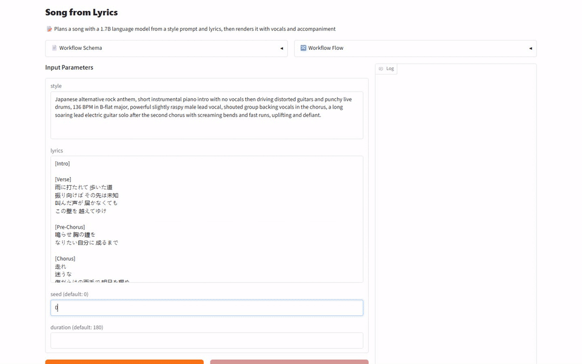
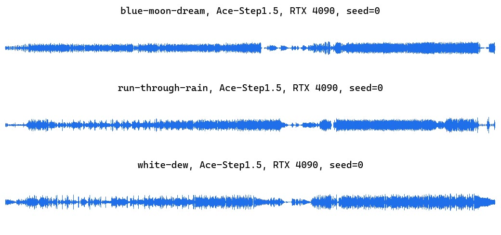
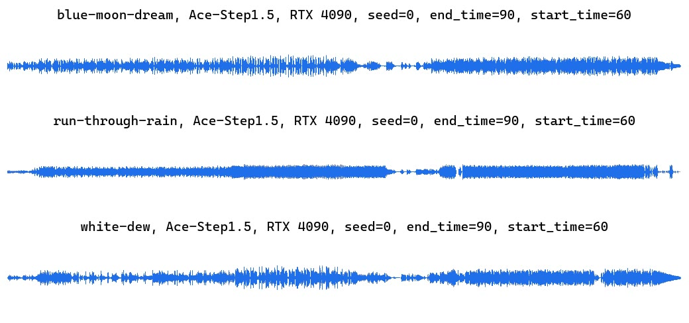
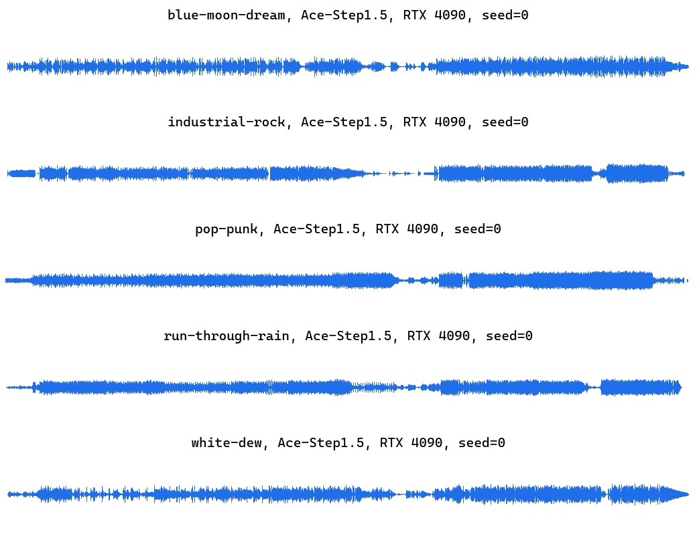

[English](README.md) · [한국어](README.ko.md) · [中文](README.zh.md)

# music-generation-ace-step

This service takes a style prompt and lyrics and returns a song with vocals and accompaniment, and it can also cover an existing song in another genre or regenerate a chosen section.



## Quick Start

It needs [model-compose](https://github.com/hanyeol/model-compose) 0.4.124 or later.

Install with [uv](https://docs.astral.sh/uv/):

```bash
uv pip install model-compose
```

Or with pip:

```bash
pip install model-compose
```

Clone this repository:

```bash
git clone https://github.com/MindrLabs/music-generation-ace-step
cd music-generation-ace-step
```

Run it:

```bash
model-compose up
```

The API listens on http://localhost:8080/api and the Gradio UI opens at http://localhost:8081.

## Summary

The RTX 4090 made one song in a median of 3.64 seconds.

| Machine | Status | Settings | RTF | Peak memory (MiB) |
| :---: | --- | --- | --- | --- |
| MacBook M1 16GB | Measured | generate | 1.02 | 28900 (footprint) |
| DGX Spark | Measured | generate | 0.045 | 16319 (VRAM) |
| RTX 4090 | Measured | generate | 0.02 | 12306 (VRAM) |

## Setup

Measured with model-compose 0.4.123. Statistics use 95% intervals, and speed differences under 1.05× are not called.

| Settings | Inputs | Weights |
| :---: | --- | --- |
| generate | 5 inputs × 3 repeats | [ACE-Step/Ace-Step1.5](https://huggingface.co/ACE-Step/Ace-Step1.5) |
| cover | 3 inputs × 3 repeats | [ACE-Step/Ace-Step1.5](https://huggingface.co/ACE-Step/Ace-Step1.5) |
| repaint | 3 inputs × 3 repeats | [ACE-Step/Ace-Step1.5](https://huggingface.co/ACE-Step/Ace-Step1.5) |

## Results

- The DGX Spark took a median of 8.12 seconds per song, while the MacBook M1 16GB took 184 seconds, about as long as the song itself.
- With so few input songs, the speed and quality differences between machines could not be confirmed statistically.

### Cover a Song

An original recording, a new style prompt and lyrics come back as the same song sung in another genre and voice.

| Claim | Check | Pass |
| :---: | --- | --- |
| A cover of an existing recording keeps the song while taking on the new style. | Judged by a person | ✓ |

We measured on MacBook M1 16GB, DGX Spark, RTX 4090. RTF is the processing time divided by the length of the audio or video, so lower is faster. Each cell is the median over measured calls, leaving out any call made during other GPU work.

| Machine | RTF | Seconds per call | Peak memory (MiB) | inner_silence_ratio | leading_silence_sec | longest_gap_sec | silence_ratio | speech_sec | trailing_silence_sec |
| :---: | --- | --- | --- | --- | --- | --- | --- | --- | --- |
| MacBook M1 16GB | 1 | 180 | 29926 (footprint) | 0.447 | 4.78 | 11.3 | 0.473 | 94.9 | 3.48 |
| DGX Spark | 0.079 | 14.2 | 17721 (VRAM) | 0.45 | 3.52 | 9.58 | 0.469 | 95.6 | 3.14 |
| RTX 4090 | 0.028 | 4.97 | 16428 (VRAM) | 0.468 | 4.88 | 9.91 | 0.497 | 90.4 | 4.79 |

| Metric | Meaning | Better |
| :---: | --- | --- |
| inner_silence_ratio | Share of the audio between the first and last sound that is silent | Neither |
| leading_silence_sec | Seconds of silence before the first sound | Neither |
| longest_gap_sec | Longest silent stretch between the first and last sound, in seconds | Lower |
| silence_ratio | Share of the whole audio that is silent | Neither |
| speech_sec | Seconds of audio above the silence threshold | Neither |
| trailing_silence_sec | Seconds of silence after the last sound | Neither |

[](https://mindrlabs.github.io/music-generation-ace-step/samples/#cover-v2.nvidia-rtx-4090-24gb)

- blue-moon-dream, Ace-Step1.5, RTX 4090, seed=0: [lyrics](docs/inputs/cover-v2/blue-moon-dream/lyrics.txt) · [source.wav](docs/inputs/cover-v2/blue-moon-dream/source.wav) · [output](docs/samples/cover-v2.nvidia-rtx-4090-24gb.c00.blue-moon-dream.r1.wav)
  > Japanese alternative rock anthem, short instrumental piano intro with no vocals then driving distorted guitars and punchy live drums, 136 BPM in B-flat major, powerful slightly raspy male lead vocal, shouted group backing vocals in the chorus, a long soaring lead electric guitar solo after the second chorus with screaming bends and fast runs, uplifting and defiant.
- run-through-rain, Ace-Step1.5, RTX 4090, seed=0: [lyrics](docs/inputs/cover-v2/run-through-rain/lyrics.txt) · [source.wav](docs/inputs/cover-v2/run-through-rain/source.wav) · [output](docs/samples/cover-v2.nvidia-rtx-4090-24gb.c00.run-through-rain.r1.wav)
  > Mandarin pop ballad, soft electric piano and warm synth pads over a light electronic pop beat, 98 BPM in G major, clear and sweet female lead vocal, gentle rounded bass, an instrumental intro with no vocals, nostalgic autumn mood.
- white-dew, Ace-Step1.5, RTX 4090, seed=0: [lyrics](docs/inputs/cover-v2/white-dew/lyrics.txt) · [source.wav](docs/inputs/cover-v2/white-dew/source.wav) · [output](docs/samples/cover-v2.nvidia-rtx-4090-24gb.c00.white-dew.r1.wav)
  > K-pop girl group trip hop in C major at 76 BPM half-time, driven by a deep, warm sub bass and a heavy, punchy breakbeat with crisp snare and booming kick up front in the mix, soft piano chords and hazy pads underneath, airy layered female vocals with close harmonies, wide stereo panning, a key change lifting into the second verse, an instrumental intro with no vocals, dreamy and hypnotic.

### Repaint a Section

An original recording, the start and end seconds of a section and a style prompt come back with that section regenerated.

| Claim | Check | Pass |
| :---: | --- | --- |
| Only the chosen section is regenerated and the rest of the recording stays as it was. | Judged by a person | ✗ |

We measured on MacBook M1 16GB, DGX Spark, RTX 4090. RTF is the processing time divided by the length of the audio or video, so lower is faster. Each cell is the median over measured calls, leaving out any call made during other GPU work.

| Machine | RTF | Seconds per call | Peak memory (MiB) | inner_silence_ratio | leading_silence_sec | longest_gap_sec | silence_ratio | speech_sec | trailing_silence_sec |
| :---: | --- | --- | --- | --- | --- | --- | --- | --- | --- |
| MacBook M1 16GB | 1 | 181 | 29927 (footprint) | 0.561 | 5.96 | 13.2 | 0.588 | 74.2 | 4.78 |
| DGX Spark | 0.076 | 13.8 | 17669 (VRAM) | 0.569 | 6.04 | 15.3 | 0.596 | 72.8 | 4.89 |
| RTX 4090 | 0.028 | 5.12 | 16378 (VRAM) | 0.551 | 6.04 | 13.2 | 0.577 | 76.1 | 4.41 |

| Metric | Meaning | Better |
| :---: | --- | --- |
| inner_silence_ratio | Share of the audio between the first and last sound that is silent | Neither |
| leading_silence_sec | Seconds of silence before the first sound | Neither |
| longest_gap_sec | Longest silent stretch between the first and last sound, in seconds | Lower |
| silence_ratio | Share of the whole audio that is silent | Neither |
| speech_sec | Seconds of audio above the silence threshold | Neither |
| trailing_silence_sec | Seconds of silence after the last sound | Neither |

[](https://mindrlabs.github.io/music-generation-ace-step/samples/#repaint-v2.nvidia-rtx-4090-24gb)

- blue-moon-dream, Ace-Step1.5, RTX 4090, seed=0, end\_time=90, start\_time=60: [lyrics](docs/inputs/repaint-v2/blue-moon-dream/lyrics.txt) · [source.wav](docs/inputs/repaint-v2/blue-moon-dream/source.wav) · [output](docs/samples/repaint-v2.nvidia-rtx-4090-24gb.c00.blue-moon-dream.r1.wav)
  > K-pop girl group trip hop in C major at 76 BPM half-time, driven by a deep, warm sub bass and a heavy, punchy breakbeat with crisp snare and booming kick up front in the mix, soft piano chords and hazy pads underneath, airy layered female vocals with close harmonies, wide stereo panning, a key change lifting into the second verse, an instrumental intro with no vocals, dreamy and hypnotic.
- run-through-rain, Ace-Step1.5, RTX 4090, seed=0, end\_time=90, start\_time=60: [lyrics](docs/inputs/repaint-v2/run-through-rain/lyrics.txt) · [source.wav](docs/inputs/repaint-v2/run-through-rain/source.wav) · [output](docs/samples/repaint-v2.nvidia-rtx-4090-24gb.c00.run-through-rain.r1.wav)
  > Japanese alternative rock anthem, short instrumental piano intro with no vocals then driving distorted guitars and punchy live drums, 136 BPM in B-flat major, powerful slightly raspy male lead vocal, shouted group backing vocals in the chorus, a long soaring lead electric guitar solo after the second chorus with screaming bends and fast runs, uplifting and defiant.
- white-dew, Ace-Step1.5, RTX 4090, seed=0, end\_time=90, start\_time=60: [lyrics](docs/inputs/repaint-v2/white-dew/lyrics.txt) · [source.wav](docs/inputs/repaint-v2/white-dew/source.wav) · [output](docs/samples/repaint-v2.nvidia-rtx-4090-24gb.c00.white-dew.r1.wav)
  > Mandarin pop ballad, soft electric piano and warm synth pads over a light electronic pop beat, 98 BPM in G major, clear and sweet female lead vocal, gentle rounded bass, an instrumental intro with no vocals, nostalgic autumn mood.

### Song from Lyrics

A style prompt naming the genre, instruments and voice, plus lyrics marked with sections, comes back as a demo song that sings those lyrics.

| Claim | Check | Pass |
| :---: | --- | --- |
| The song follows the genre, instruments and timbre named in the style prompt. | Judged by a person | ✓ |
| Lyrics are sung in the language they are written in, following their section structure. | Judged by a person | ✓ |

We measured on MacBook M1 16GB, DGX Spark, RTX 4090. RTF is the processing time divided by the length of the audio or video, so lower is faster. Each cell is the median over measured calls, leaving out any call made during other GPU work.

| Machine | RTF | Seconds per call | Peak memory (MiB) | aes_ce | aes_cu | aes_pc | aes_pq | inner_silence_ratio | leading_silence_sec | longest_gap_sec | silence_ratio | songeval_clarity | songeval_coherence | songeval_memorability | songeval_musicality | songeval_naturalness | speech_sec | trailing_silence_sec |
| :---: | --- | --- | --- | --- | --- | --- | --- | --- | --- | --- | --- | --- | --- | --- | --- | --- | --- | --- |
| MacBook M1 16GB | 1.02 | 184 | 28900 (footprint) | 7.66 | 7.94 | 6.32 | 8.3 | 0.387 | 1.97 | 7.15 | 0.414 | 4.21 | 4.35 | 4.35 | 4.23 | 4.18 | 106 | 6.6 |
| DGX Spark | 0.045 | 8.12 | 16319 (VRAM) | 7.63 | 7.91 | 6.41 | 8.27 | 0.34 | 3.4 | 8.29 | 0.367 | 4.22 | 4.4 | 4.4 | 4.25 | 4.21 | 114 | 3.77 |
| RTX 4090 | 0.02 | 3.64 | 12306 (VRAM) | 7.64 | 7.87 | 6.38 | 8.26 | 0.438 | 4.61 | 8.74 | 0.472 | 4.2 | 4.34 | 4.37 | 4.24 | 4.16 | 95 | 7.24 |

| Metric | Meaning | Better |
| :---: | --- | --- |
| aes_ce | Audiobox Aesthetics content enjoyment, about 1 to 10 | Higher |
| aes_cu | Audiobox Aesthetics content usefulness, about 1 to 10 | Higher |
| aes_pc | Audiobox Aesthetics production complexity, about 1 to 10 | Neither |
| aes_pq | Audiobox Aesthetics production quality, about 1 to 10 | Higher |
| inner_silence_ratio | Share of the audio between the first and last sound that is silent | Neither |
| leading_silence_sec | Seconds of silence before the first sound | Neither |
| longest_gap_sec | Longest silent stretch between the first and last sound, in seconds | Lower |
| silence_ratio | Share of the whole audio that is silent | Neither |
| songeval_clarity | SongEval clarity of song structure, 1 to 5 | Higher |
| songeval_coherence | SongEval overall coherence, 1 to 5 | Higher |
| songeval_memorability | SongEval memorability, 1 to 5 | Higher |
| songeval_musicality | SongEval overall musicality, 1 to 5 | Higher |
| songeval_naturalness | SongEval naturalness of vocal breathing and phrasing, 1 to 5 | Higher |
| speech_sec | Seconds of audio above the silence threshold | Neither |
| trailing_silence_sec | Seconds of silence after the last sound | Neither |

[](https://mindrlabs.github.io/music-generation-ace-step/samples/#generate-v2.nvidia-rtx-4090-24gb)

- blue-moon-dream, Ace-Step1.5, RTX 4090, seed=0: [lyrics](docs/inputs/generate-v2/blue-moon-dream/lyrics.txt) · [output](docs/samples/generate-v2.nvidia-rtx-4090-24gb.c00.blue-moon-dream.r1.wav)
  > K-pop girl group trip hop in C major at 76 BPM half-time, driven by a deep, warm sub bass and a heavy, punchy breakbeat with crisp snare and booming kick up front in the mix, soft piano chords and hazy pads underneath, airy layered female vocals with close harmonies, wide stereo panning, a key change lifting into the second verse, an instrumental intro with no vocals, dreamy and hypnotic.
- industrial-rock, Ace-Step1.5, RTX 4090, seed=0: [lyrics](docs/inputs/generate-v2/industrial-rock/lyrics.txt) · [output](docs/samples/generate-v2.nvidia-rtx-4090-24gb.c00.industrial-rock.r1.wav)
  > Dark industrial pop rock with grunge grit, a heavy distorted bass riff, stomping drums with hard claps, gritty fuzz guitars, a shouted chorus, male lead vocal with gang vocals, 139 BPM in D-sharp minor, an instrumental bass intro with no vocals, menacing and intense.
- pop-punk, Ace-Step1.5, RTX 4090, seed=0: [lyrics](docs/inputs/generate-v2/pop-punk/lyrics.txt) · [output](docs/samples/generate-v2.nvidia-rtx-4090-24gb.c00.pop-punk.r1.wav)
  > Early-2000s pop-punk, crunchy power-chord electric guitars, palm-muted verses bursting into a big open chorus, driving punk drums and bass, 150 BPM in D major, bratty and confident female lead vocal, an instrumental guitar intro with no vocals, rebellious teenage energy.
- run-through-rain, Ace-Step1.5, RTX 4090, seed=0: [lyrics](docs/inputs/generate-v2/run-through-rain/lyrics.txt) · [output](docs/samples/generate-v2.nvidia-rtx-4090-24gb.c00.run-through-rain.r1.wav)
  > Japanese alternative rock anthem, short instrumental piano intro with no vocals then driving distorted guitars and punchy live drums, 136 BPM in B-flat major, powerful slightly raspy male lead vocal, shouted group backing vocals in the chorus, a long soaring lead electric guitar solo after the second chorus with screaming bends and fast runs, uplifting and defiant.
- white-dew, Ace-Step1.5, RTX 4090, seed=0: [lyrics](docs/inputs/generate-v2/white-dew/lyrics.txt) · [output](docs/samples/generate-v2.nvidia-rtx-4090-24gb.c00.white-dew.r1.wav)
  > Mandarin pop ballad, soft electric piano and warm synth pads over a light electronic pop beat, 98 BPM in G major, clear and sweet female lead vocal, gentle rounded bass, an instrumental intro with no vocals, nostalgic autumn mood.

## Recommendations

- To try many styles quickly, run it on the RTX 4090 or the DGX Spark, where a song takes seconds.
- Repaint also changed the part before the chosen section, so listen to the whole song before using it.

## Limitations and What We Did Not Measure

- Repaint regenerated the chosen section, but a listener heard that the part before it no longer matched the original and that the section boundaries did not join smoothly.

### Measurement Conditions

| Item | Detail |
| :---: | --- |
| Constraint | Measured only with the turbo checkpoint at 8 inference steps; the base and SFT checkpoints were not measured. |
| Constraint | On Apple M1 the MPS memory limit was lifted with PYTORCH_MPS_HIGH_WATERMARK_RATIO=0.0, because the default limit ran out of memory. |
| Constraint | On DGX Spark the thinking LM ran without flash_attn and with CUDA graphs disabled. |

### Not Measured

| Subject | Item | Reason |
| :---: | --- | --- |
| MacBook M1 16GB vs DGX Spark | RTF | Only 5 inputs were measured on both machines without other GPU work; at least 20 are needed. |
| MacBook M1 16GB vs RTX 4090 | RTF | Only 5 inputs were measured on both machines without other GPU work; at least 20 are needed. |
| DGX Spark vs RTX 4090 | RTF | Only 5 inputs were measured on both machines without other GPU work; at least 20 are needed. |
| MacBook M1 16GB vs DGX Spark | aes_ce | Only 5 inputs were scored on both machines; at least 20 are needed. |
| MacBook M1 16GB vs RTX 4090 | aes_ce | Only 5 inputs were scored on both machines; at least 20 are needed. |
| DGX Spark vs RTX 4090 | aes_ce | Only 5 inputs were scored on both machines; at least 20 are needed. |
| MacBook M1 16GB vs DGX Spark | aes_cu | Only 5 inputs were scored on both machines; at least 20 are needed. |
| MacBook M1 16GB vs RTX 4090 | aes_cu | Only 5 inputs were scored on both machines; at least 20 are needed. |
| DGX Spark vs RTX 4090 | aes_cu | Only 5 inputs were scored on both machines; at least 20 are needed. |
| MacBook M1 16GB vs DGX Spark | aes_pq | Only 5 inputs were scored on both machines; at least 20 are needed. |
| MacBook M1 16GB vs RTX 4090 | aes_pq | Only 5 inputs were scored on both machines; at least 20 are needed. |
| DGX Spark vs RTX 4090 | aes_pq | Only 5 inputs were scored on both machines; at least 20 are needed. |
| MacBook M1 16GB vs DGX Spark | longest_gap_sec | Only 5 inputs were scored on both machines; at least 20 are needed. |
| MacBook M1 16GB vs RTX 4090 | longest_gap_sec | Only 5 inputs were scored on both machines; at least 20 are needed. |
| DGX Spark vs RTX 4090 | longest_gap_sec | Only 5 inputs were scored on both machines; at least 20 are needed. |
| MacBook M1 16GB vs DGX Spark | songeval_clarity | Only 5 inputs were scored on both machines; at least 20 are needed. |
| MacBook M1 16GB vs RTX 4090 | songeval_clarity | Only 5 inputs were scored on both machines; at least 20 are needed. |
| DGX Spark vs RTX 4090 | songeval_clarity | Only 5 inputs were scored on both machines; at least 20 are needed. |
| MacBook M1 16GB vs DGX Spark | songeval_coherence | Only 5 inputs were scored on both machines; at least 20 are needed. |
| MacBook M1 16GB vs RTX 4090 | songeval_coherence | Only 5 inputs were scored on both machines; at least 20 are needed. |
| DGX Spark vs RTX 4090 | songeval_coherence | Only 5 inputs were scored on both machines; at least 20 are needed. |
| MacBook M1 16GB vs DGX Spark | songeval_memorability | Only 5 inputs were scored on both machines; at least 20 are needed. |
| MacBook M1 16GB vs RTX 4090 | songeval_memorability | Only 5 inputs were scored on both machines; at least 20 are needed. |
| DGX Spark vs RTX 4090 | songeval_memorability | Only 5 inputs were scored on both machines; at least 20 are needed. |
| MacBook M1 16GB vs DGX Spark | songeval_musicality | Only 5 inputs were scored on both machines; at least 20 are needed. |
| MacBook M1 16GB vs RTX 4090 | songeval_musicality | Only 5 inputs were scored on both machines; at least 20 are needed. |
| DGX Spark vs RTX 4090 | songeval_musicality | Only 5 inputs were scored on both machines; at least 20 are needed. |
| MacBook M1 16GB vs DGX Spark | songeval_naturalness | Only 5 inputs were scored on both machines; at least 20 are needed. |
| MacBook M1 16GB vs RTX 4090 | songeval_naturalness | Only 5 inputs were scored on both machines; at least 20 are needed. |
| DGX Spark vs RTX 4090 | songeval_naturalness | Only 5 inputs were scored on both machines; at least 20 are needed. |
| MacBook M1 16GB vs DGX Spark | RTF | Only 3 inputs were measured on both machines without other GPU work; at least 20 are needed. |
| MacBook M1 16GB vs RTX 4090 | RTF | Only 3 inputs were measured on both machines without other GPU work; at least 20 are needed. |
| DGX Spark vs RTX 4090 | RTF | Only 3 inputs were measured on both machines without other GPU work; at least 20 are needed. |
| MacBook M1 16GB vs DGX Spark | longest_gap_sec | Only 3 inputs were scored on both machines; at least 20 are needed. |
| MacBook M1 16GB vs RTX 4090 | longest_gap_sec | Only 3 inputs were scored on both machines; at least 20 are needed. |
| DGX Spark vs RTX 4090 | longest_gap_sec | Only 3 inputs were scored on both machines; at least 20 are needed. |

### Unchecked Model Card Claims

- A new track of the chosen kind is added on top of the recording.
- Song quality sits between Suno v4.5 and Suno v5.
- Generated music can be used commercially.
- The base checkpoint continues a recording past its end in the same song.
- It generates audio from 10 seconds to 10 minutes long.
- The turbo checkpoint does not support Extract, Lego or Complete.
- A full song takes under 10 seconds on an RTX 3090 and under 2 seconds on an A100.
- It runs locally with less than 4GB of VRAM.
- An accompaniment that fits a vocal-only track is generated for it.

## License

| Covers | License | Commercial use |
| :---: | --- | --- |
| This service | [`LICENSE`](LICENSE) | ✓ |
| ACE-Step/Ace-Step1.5 weights | [`MODEL_LICENSE`](https://huggingface.co/ACE-Step/Ace-Step1.5/blob/main/README.md) | ✓ |
