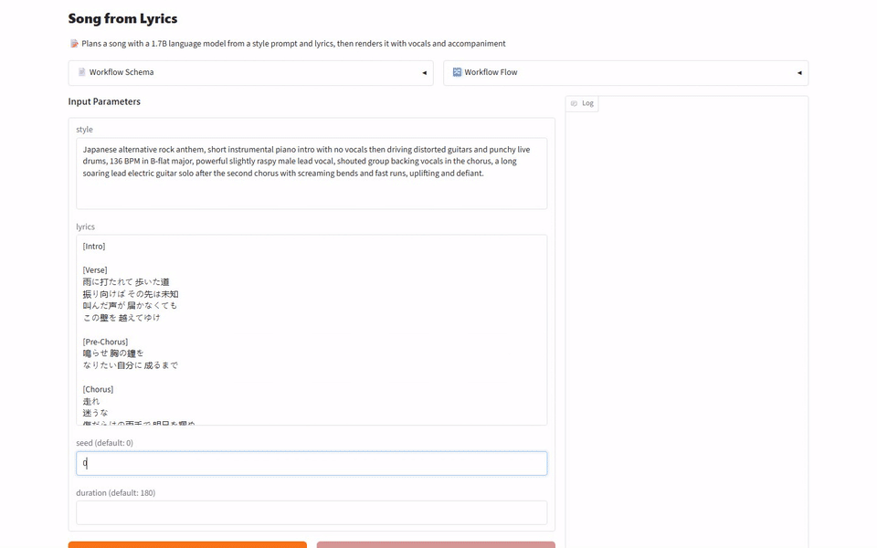
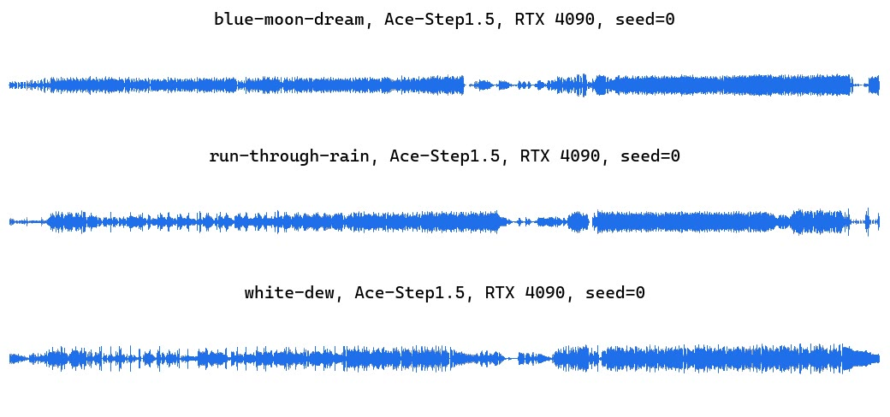
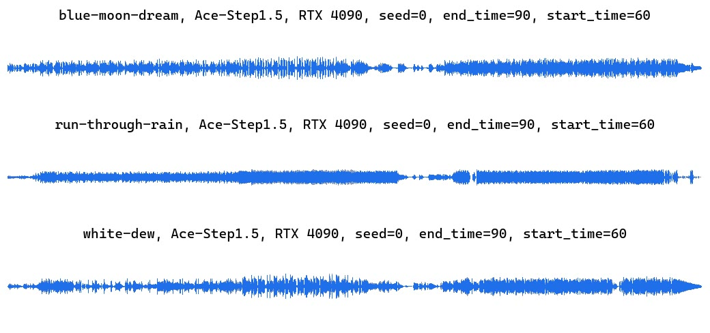
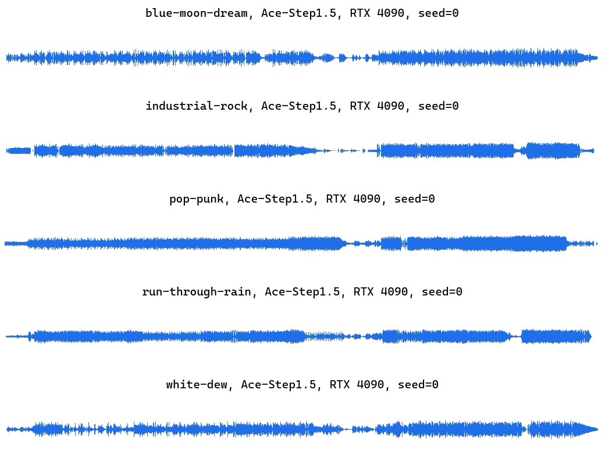

[English](README.md) · [한국어](README.ko.md) · [中文](README.zh.md)

# music-generation-ace-step

本服务接收风格描述和歌词，生成带人声和伴奏的歌曲，还能把已有歌曲翻唱成其他曲风，或重新生成选定的片段。



## 快速开始

需要 [model-compose](https://github.com/hanyeol/model-compose) 0.4.124 或更高版本。

使用 [uv](https://docs.astral.sh/uv/) 安装：

```bash
uv pip install model-compose
```

或使用 pip 安装：

```bash
pip install model-compose
```

克隆此仓库：

```bash
git clone https://github.com/MindrLabs/music-generation-ace-step
cd music-generation-ace-step
```

运行：

```bash
model-compose up
```

API 地址为 http://localhost:8080/api ，Gradio 界面地址为 http://localhost:8081 。

## 摘要

RTX 4090 生成一首歌的中位耗时为 3.64 秒。

| 设备 | 状态 | 设置 | RTF | 峰值内存 (MiB) |
| :---: | --- | --- | --- | --- |
| MacBook M1 16GB | 已测量 | generate | 1.02 | 28900 (footprint) |
| DGX Spark | 已测量 | generate | 0.045 | 16319 (VRAM) |
| RTX 4090 | 已测量 | generate | 0.02 | 12306 (VRAM) |

## 测量环境

使用 model-compose 0.4.123 测量。统计使用 95% 置信区间，低于 1.05× 的速度差异不作判定。

| 设置 | 输入 | 权重 |
| :---: | --- | --- |
| generate | 5 个输入 × 3 次重复 | [ACE-Step/Ace-Step1.5](https://huggingface.co/ACE-Step/Ace-Step1.5) |
| cover | 3 个输入 × 3 次重复 | [ACE-Step/Ace-Step1.5](https://huggingface.co/ACE-Step/Ace-Step1.5) |
| repaint | 3 个输入 × 3 次重复 | [ACE-Step/Ace-Step1.5](https://huggingface.co/ACE-Step/Ace-Step1.5) |

## 结果

- DGX Spark 每首歌的中位耗时为 8.12 秒，MacBook M1 16GB 则需要 184 秒，与歌曲本身的长度相当。
- 输入歌曲太少，未能在统计上确认各设备之间的速度和质量差异。

### 翻唱歌曲

输入原曲音频、新的风格描述和歌词，即可用另一种曲风和人声重新演唱同一首歌。

| 声明 | 核对方式 | 通过 |
| :---: | --- | --- |
| 翻唱已有录音时保留原曲，同时换上新的风格。 | 人工判定 | ✓ |

在 MacBook M1 16GB、DGX Spark、RTX 4090 上进行了测量。RTF 是处理耗时除以音频或视频时长，越低越快。每格为所测调用的中位数，计算时不计入在其他 GPU 任务期间进行的调用。

| 设备 | RTF | 每次调用秒数 | 峰值内存 (MiB) | inner_silence_ratio | leading_silence_sec | longest_gap_sec | silence_ratio | speech_sec | trailing_silence_sec |
| :---: | --- | --- | --- | --- | --- | --- | --- | --- | --- |
| MacBook M1 16GB | 1 | 180 | 29926 (footprint) | 0.447 | 4.78 | 11.3 | 0.473 | 94.9 | 3.48 |
| DGX Spark | 0.079 | 14.2 | 17721 (VRAM) | 0.45 | 3.52 | 9.58 | 0.469 | 95.6 | 3.14 |
| RTX 4090 | 0.028 | 4.97 | 16428 (VRAM) | 0.468 | 4.88 | 9.91 | 0.497 | 90.4 | 4.79 |

| 指标 | 含义 | 更好的方向 |
| :---: | --- | --- |
| inner_silence_ratio | 第一个与最后一个声音之间静音所占比例 | 无 |
| leading_silence_sec | 第一个声音之前的静音秒数 | 无 |
| longest_gap_sec | 第一个与最后一个声音之间最长的静音秒数 | 越低 |
| silence_ratio | 整段音频中静音所占比例 | 无 |
| speech_sec | 高于静音阈值的音频秒数 | 无 |
| trailing_silence_sec | 最后一个声音之后的静音秒数 | 无 |

[](https://mindrlabs.github.io/music-generation-ace-step/samples/#cover-v2.nvidia-rtx-4090-24gb)

- blue-moon-dream, Ace-Step1.5, RTX 4090, seed=0: [lyrics](docs/inputs/cover-v2/blue-moon-dream/lyrics.txt) · [source.wav](docs/inputs/cover-v2/blue-moon-dream/source.wav) · [输出](docs/samples/cover-v2.nvidia-rtx-4090-24gb.c00.blue-moon-dream.r1.wav)
  > Japanese alternative rock anthem, short instrumental piano intro with no vocals then driving distorted guitars and punchy live drums, 136 BPM in B-flat major, powerful slightly raspy male lead vocal, shouted group backing vocals in the chorus, a long soaring lead electric guitar solo after the second chorus with screaming bends and fast runs, uplifting and defiant.
- run-through-rain, Ace-Step1.5, RTX 4090, seed=0: [lyrics](docs/inputs/cover-v2/run-through-rain/lyrics.txt) · [source.wav](docs/inputs/cover-v2/run-through-rain/source.wav) · [输出](docs/samples/cover-v2.nvidia-rtx-4090-24gb.c00.run-through-rain.r1.wav)
  > Mandarin pop ballad, soft electric piano and warm synth pads over a light electronic pop beat, 98 BPM in G major, clear and sweet female lead vocal, gentle rounded bass, an instrumental intro with no vocals, nostalgic autumn mood.
- white-dew, Ace-Step1.5, RTX 4090, seed=0: [lyrics](docs/inputs/cover-v2/white-dew/lyrics.txt) · [source.wav](docs/inputs/cover-v2/white-dew/source.wav) · [输出](docs/samples/cover-v2.nvidia-rtx-4090-24gb.c00.white-dew.r1.wav)
  > K-pop girl group trip hop in C major at 76 BPM half-time, driven by a deep, warm sub bass and a heavy, punchy breakbeat with crisp snare and booming kick up front in the mix, soft piano chords and hazy pads underneath, airy layered female vocals with close harmonies, wide stereo panning, a key change lifting into the second verse, an instrumental intro with no vocals, dreamy and hypnotic.

### 局部重绘

输入原曲音频、要重新生成片段的起止秒数和风格描述，即可重新生成该片段。

| 声明 | 核对方式 | 通过 |
| :---: | --- | --- |
| 只重新生成选定的片段，录音其余部分保持原样。 | 人工判定 | ✗ |

在 MacBook M1 16GB、DGX Spark、RTX 4090 上进行了测量。RTF 是处理耗时除以音频或视频时长，越低越快。每格为所测调用的中位数，计算时不计入在其他 GPU 任务期间进行的调用。

| 设备 | RTF | 每次调用秒数 | 峰值内存 (MiB) | inner_silence_ratio | leading_silence_sec | longest_gap_sec | silence_ratio | speech_sec | trailing_silence_sec |
| :---: | --- | --- | --- | --- | --- | --- | --- | --- | --- |
| MacBook M1 16GB | 1 | 181 | 29927 (footprint) | 0.561 | 5.96 | 13.2 | 0.588 | 74.2 | 4.78 |
| DGX Spark | 0.076 | 13.8 | 17669 (VRAM) | 0.569 | 6.04 | 15.3 | 0.596 | 72.8 | 4.89 |
| RTX 4090 | 0.028 | 5.12 | 16378 (VRAM) | 0.551 | 6.04 | 13.2 | 0.577 | 76.1 | 4.41 |

| 指标 | 含义 | 更好的方向 |
| :---: | --- | --- |
| inner_silence_ratio | 第一个与最后一个声音之间静音所占比例 | 无 |
| leading_silence_sec | 第一个声音之前的静音秒数 | 无 |
| longest_gap_sec | 第一个与最后一个声音之间最长的静音秒数 | 越低 |
| silence_ratio | 整段音频中静音所占比例 | 无 |
| speech_sec | 高于静音阈值的音频秒数 | 无 |
| trailing_silence_sec | 最后一个声音之后的静音秒数 | 无 |

[](https://mindrlabs.github.io/music-generation-ace-step/samples/#repaint-v2.nvidia-rtx-4090-24gb)

- blue-moon-dream, Ace-Step1.5, RTX 4090, seed=0, end\_time=90, start\_time=60: [lyrics](docs/inputs/repaint-v2/blue-moon-dream/lyrics.txt) · [source.wav](docs/inputs/repaint-v2/blue-moon-dream/source.wav) · [输出](docs/samples/repaint-v2.nvidia-rtx-4090-24gb.c00.blue-moon-dream.r1.wav)
  > K-pop girl group trip hop in C major at 76 BPM half-time, driven by a deep, warm sub bass and a heavy, punchy breakbeat with crisp snare and booming kick up front in the mix, soft piano chords and hazy pads underneath, airy layered female vocals with close harmonies, wide stereo panning, a key change lifting into the second verse, an instrumental intro with no vocals, dreamy and hypnotic.
- run-through-rain, Ace-Step1.5, RTX 4090, seed=0, end\_time=90, start\_time=60: [lyrics](docs/inputs/repaint-v2/run-through-rain/lyrics.txt) · [source.wav](docs/inputs/repaint-v2/run-through-rain/source.wav) · [输出](docs/samples/repaint-v2.nvidia-rtx-4090-24gb.c00.run-through-rain.r1.wav)
  > Japanese alternative rock anthem, short instrumental piano intro with no vocals then driving distorted guitars and punchy live drums, 136 BPM in B-flat major, powerful slightly raspy male lead vocal, shouted group backing vocals in the chorus, a long soaring lead electric guitar solo after the second chorus with screaming bends and fast runs, uplifting and defiant.
- white-dew, Ace-Step1.5, RTX 4090, seed=0, end\_time=90, start\_time=60: [lyrics](docs/inputs/repaint-v2/white-dew/lyrics.txt) · [source.wav](docs/inputs/repaint-v2/white-dew/source.wav) · [输出](docs/samples/repaint-v2.nvidia-rtx-4090-24gb.c00.white-dew.r1.wav)
  > Mandarin pop ballad, soft electric piano and warm synth pads over a light electronic pop beat, 98 BPM in G major, clear and sweet female lead vocal, gentle rounded bass, an instrumental intro with no vocals, nostalgic autumn mood.

### 歌词生成歌曲

输入写明曲风、乐器和人声的风格描述以及标好段落的歌词，即可得到演唱这些歌词的小样。

| 声明 | 核对方式 | 通过 |
| :---: | --- | --- |
| 歌曲遵循风格描述中指定的曲风、乐器和音色。 | 人工判定 | ✓ |
| 按歌词所写的语言、依照段落结构演唱。 | 人工判定 | ✓ |

在 MacBook M1 16GB、DGX Spark、RTX 4090 上进行了测量。RTF 是处理耗时除以音频或视频时长，越低越快。每格为所测调用的中位数，计算时不计入在其他 GPU 任务期间进行的调用。

| 设备 | RTF | 每次调用秒数 | 峰值内存 (MiB) | aes_ce | aes_cu | aes_pc | aes_pq | inner_silence_ratio | leading_silence_sec | longest_gap_sec | silence_ratio | songeval_clarity | songeval_coherence | songeval_memorability | songeval_musicality | songeval_naturalness | speech_sec | trailing_silence_sec |
| :---: | --- | --- | --- | --- | --- | --- | --- | --- | --- | --- | --- | --- | --- | --- | --- | --- | --- | --- |
| MacBook M1 16GB | 1.02 | 184 | 28900 (footprint) | 7.66 | 7.94 | 6.32 | 8.3 | 0.387 | 1.97 | 7.15 | 0.414 | 4.21 | 4.35 | 4.35 | 4.23 | 4.18 | 106 | 6.6 |
| DGX Spark | 0.045 | 8.12 | 16319 (VRAM) | 7.63 | 7.91 | 6.41 | 8.27 | 0.34 | 3.4 | 8.29 | 0.367 | 4.22 | 4.4 | 4.4 | 4.25 | 4.21 | 114 | 3.77 |
| RTX 4090 | 0.02 | 3.64 | 12306 (VRAM) | 7.64 | 7.87 | 6.38 | 8.26 | 0.438 | 4.61 | 8.74 | 0.472 | 4.2 | 4.34 | 4.37 | 4.24 | 4.16 | 95 | 7.24 |

| 指标 | 含义 | 更好的方向 |
| :---: | --- | --- |
| aes_ce | Audiobox Aesthetics 内容享受度，约 1 到 10 | 越高 |
| aes_cu | Audiobox Aesthetics 内容实用性，约 1 到 10 | 越高 |
| aes_pc | Audiobox Aesthetics 制作复杂度，约 1 到 10 | 无 |
| aes_pq | Audiobox Aesthetics 制作质量，约 1 到 10 | 越高 |
| inner_silence_ratio | 第一个与最后一个声音之间静音所占比例 | 无 |
| leading_silence_sec | 第一个声音之前的静音秒数 | 无 |
| longest_gap_sec | 第一个与最后一个声音之间最长的静音秒数 | 越低 |
| silence_ratio | 整段音频中静音所占比例 | 无 |
| songeval_clarity | SongEval 歌曲结构清晰度，1 到 5 | 越高 |
| songeval_coherence | SongEval 整体连贯性，1 到 5 | 越高 |
| songeval_memorability | SongEval 记忆度，1 到 5 | 越高 |
| songeval_musicality | SongEval 整体音乐性，1 到 5 | 越高 |
| songeval_naturalness | SongEval 人声呼吸与乐句的自然度，1 到 5 | 越高 |
| speech_sec | 高于静音阈值的音频秒数 | 无 |
| trailing_silence_sec | 最后一个声音之后的静音秒数 | 无 |

[](https://mindrlabs.github.io/music-generation-ace-step/samples/#generate-v2.nvidia-rtx-4090-24gb)

- blue-moon-dream, Ace-Step1.5, RTX 4090, seed=0: [lyrics](docs/inputs/generate-v2/blue-moon-dream/lyrics.txt) · [输出](docs/samples/generate-v2.nvidia-rtx-4090-24gb.c00.blue-moon-dream.r1.wav)
  > K-pop girl group trip hop in C major at 76 BPM half-time, driven by a deep, warm sub bass and a heavy, punchy breakbeat with crisp snare and booming kick up front in the mix, soft piano chords and hazy pads underneath, airy layered female vocals with close harmonies, wide stereo panning, a key change lifting into the second verse, an instrumental intro with no vocals, dreamy and hypnotic.
- industrial-rock, Ace-Step1.5, RTX 4090, seed=0: [lyrics](docs/inputs/generate-v2/industrial-rock/lyrics.txt) · [输出](docs/samples/generate-v2.nvidia-rtx-4090-24gb.c00.industrial-rock.r1.wav)
  > Dark industrial pop rock with grunge grit, a heavy distorted bass riff, stomping drums with hard claps, gritty fuzz guitars, a shouted chorus, male lead vocal with gang vocals, 139 BPM in D-sharp minor, an instrumental bass intro with no vocals, menacing and intense.
- pop-punk, Ace-Step1.5, RTX 4090, seed=0: [lyrics](docs/inputs/generate-v2/pop-punk/lyrics.txt) · [输出](docs/samples/generate-v2.nvidia-rtx-4090-24gb.c00.pop-punk.r1.wav)
  > Early-2000s pop-punk, crunchy power-chord electric guitars, palm-muted verses bursting into a big open chorus, driving punk drums and bass, 150 BPM in D major, bratty and confident female lead vocal, an instrumental guitar intro with no vocals, rebellious teenage energy.
- run-through-rain, Ace-Step1.5, RTX 4090, seed=0: [lyrics](docs/inputs/generate-v2/run-through-rain/lyrics.txt) · [输出](docs/samples/generate-v2.nvidia-rtx-4090-24gb.c00.run-through-rain.r1.wav)
  > Japanese alternative rock anthem, short instrumental piano intro with no vocals then driving distorted guitars and punchy live drums, 136 BPM in B-flat major, powerful slightly raspy male lead vocal, shouted group backing vocals in the chorus, a long soaring lead electric guitar solo after the second chorus with screaming bends and fast runs, uplifting and defiant.
- white-dew, Ace-Step1.5, RTX 4090, seed=0: [lyrics](docs/inputs/generate-v2/white-dew/lyrics.txt) · [输出](docs/samples/generate-v2.nvidia-rtx-4090-24gb.c00.white-dew.r1.wav)
  > Mandarin pop ballad, soft electric piano and warm synth pads over a light electronic pop beat, 98 BPM in G major, clear and sweet female lead vocal, gentle rounded bass, an instrumental intro with no vocals, nostalgic autumn mood.

## 建议

- 想快速试听多种风格时，建议在每首歌只需几秒的 RTX 4090 或 DGX Spark 上运行。
- 局部重绘连选定片段之前的部分也与原曲不同了，使用前建议完整试听整首歌。

## 局限与未测量的内容

- 局部重绘重新生成了选定的片段，但人工试听发现片段之前的部分也与原曲不再相同，片段边界衔接也不顺畅。

### 测量条件

| 项目 | 内容 |
| :---: | --- |
| 限制 | 仅以 8 步推理测量了 turbo 检查点，未测量 base 和 SFT 检查点。 |
| 限制 | 在 Apple M1 上默认上限会内存不足，因此用 PYTORCH_MPS_HIGH_WATERMARK_RATIO=0.0 解除了 MPS 内存上限。 |
| 限制 | 在 DGX Spark 上，思考用 LM 在没有 flash_attn、关闭 CUDA 图的情况下运行。 |

### 未能测量的内容

| 对象 | 项目 | 原因 |
| :---: | --- | --- |
| MacBook M1 16GB 与 DGX Spark | RTF | 两台设备在无其他 GPU 任务时测得的输入只有 5 个，至少需要 20 个。 |
| MacBook M1 16GB 与 RTX 4090 | RTF | 两台设备在无其他 GPU 任务时测得的输入只有 5 个，至少需要 20 个。 |
| DGX Spark 与 RTX 4090 | RTF | 两台设备在无其他 GPU 任务时测得的输入只有 5 个，至少需要 20 个。 |
| MacBook M1 16GB 与 DGX Spark | aes_ce | 两台设备都评分的输入只有 5 个，至少需要 20 个。 |
| MacBook M1 16GB 与 RTX 4090 | aes_ce | 两台设备都评分的输入只有 5 个，至少需要 20 个。 |
| DGX Spark 与 RTX 4090 | aes_ce | 两台设备都评分的输入只有 5 个，至少需要 20 个。 |
| MacBook M1 16GB 与 DGX Spark | aes_cu | 两台设备都评分的输入只有 5 个，至少需要 20 个。 |
| MacBook M1 16GB 与 RTX 4090 | aes_cu | 两台设备都评分的输入只有 5 个，至少需要 20 个。 |
| DGX Spark 与 RTX 4090 | aes_cu | 两台设备都评分的输入只有 5 个，至少需要 20 个。 |
| MacBook M1 16GB 与 DGX Spark | aes_pq | 两台设备都评分的输入只有 5 个，至少需要 20 个。 |
| MacBook M1 16GB 与 RTX 4090 | aes_pq | 两台设备都评分的输入只有 5 个，至少需要 20 个。 |
| DGX Spark 与 RTX 4090 | aes_pq | 两台设备都评分的输入只有 5 个，至少需要 20 个。 |
| MacBook M1 16GB 与 DGX Spark | longest_gap_sec | 两台设备都评分的输入只有 5 个，至少需要 20 个。 |
| MacBook M1 16GB 与 RTX 4090 | longest_gap_sec | 两台设备都评分的输入只有 5 个，至少需要 20 个。 |
| DGX Spark 与 RTX 4090 | longest_gap_sec | 两台设备都评分的输入只有 5 个，至少需要 20 个。 |
| MacBook M1 16GB 与 DGX Spark | songeval_clarity | 两台设备都评分的输入只有 5 个，至少需要 20 个。 |
| MacBook M1 16GB 与 RTX 4090 | songeval_clarity | 两台设备都评分的输入只有 5 个，至少需要 20 个。 |
| DGX Spark 与 RTX 4090 | songeval_clarity | 两台设备都评分的输入只有 5 个，至少需要 20 个。 |
| MacBook M1 16GB 与 DGX Spark | songeval_coherence | 两台设备都评分的输入只有 5 个，至少需要 20 个。 |
| MacBook M1 16GB 与 RTX 4090 | songeval_coherence | 两台设备都评分的输入只有 5 个，至少需要 20 个。 |
| DGX Spark 与 RTX 4090 | songeval_coherence | 两台设备都评分的输入只有 5 个，至少需要 20 个。 |
| MacBook M1 16GB 与 DGX Spark | songeval_memorability | 两台设备都评分的输入只有 5 个，至少需要 20 个。 |
| MacBook M1 16GB 与 RTX 4090 | songeval_memorability | 两台设备都评分的输入只有 5 个，至少需要 20 个。 |
| DGX Spark 与 RTX 4090 | songeval_memorability | 两台设备都评分的输入只有 5 个，至少需要 20 个。 |
| MacBook M1 16GB 与 DGX Spark | songeval_musicality | 两台设备都评分的输入只有 5 个，至少需要 20 个。 |
| MacBook M1 16GB 与 RTX 4090 | songeval_musicality | 两台设备都评分的输入只有 5 个，至少需要 20 个。 |
| DGX Spark 与 RTX 4090 | songeval_musicality | 两台设备都评分的输入只有 5 个，至少需要 20 个。 |
| MacBook M1 16GB 与 DGX Spark | songeval_naturalness | 两台设备都评分的输入只有 5 个，至少需要 20 个。 |
| MacBook M1 16GB 与 RTX 4090 | songeval_naturalness | 两台设备都评分的输入只有 5 个，至少需要 20 个。 |
| DGX Spark 与 RTX 4090 | songeval_naturalness | 两台设备都评分的输入只有 5 个，至少需要 20 个。 |
| MacBook M1 16GB 与 DGX Spark | RTF | 两台设备在无其他 GPU 任务时测得的输入只有 3 个，至少需要 20 个。 |
| MacBook M1 16GB 与 RTX 4090 | RTF | 两台设备在无其他 GPU 任务时测得的输入只有 3 个，至少需要 20 个。 |
| DGX Spark 与 RTX 4090 | RTF | 两台设备在无其他 GPU 任务时测得的输入只有 3 个，至少需要 20 个。 |
| MacBook M1 16GB 与 DGX Spark | longest_gap_sec | 两台设备都评分的输入只有 3 个，至少需要 20 个。 |
| MacBook M1 16GB 与 RTX 4090 | longest_gap_sec | 两台设备都评分的输入只有 3 个，至少需要 20 个。 |
| DGX Spark 与 RTX 4090 | longest_gap_sec | 两台设备都评分的输入只有 3 个，至少需要 20 个。 |

### 未核实的模型卡声明

- 在录音之上添加所选类型的新音轨。
- 歌曲质量介于 Suno v4.5 和 Suno v5 之间。
- 生成的音乐可用于商业用途。
- base 检查点能把录音在结尾之后以同一首歌续写下去。
- 可生成 10 秒到 10 分钟长的音频。
- turbo 检查点不支持 Extract、Lego 和 Complete。
- 一首完整歌曲在 RTX 3090 上不到 10 秒，在 A100 上不到 2 秒。
- 可在不到 4GB 显存的本地环境运行。
- 为只有人声的音轨生成合适的伴奏。

## 许可证

| 适用对象 | 许可证 | 商业使用 |
| :---: | --- | --- |
| 本服务 | [`LICENSE`](LICENSE) | ✓ |
| ACE-Step/Ace-Step1.5 权重 | [`MODEL_LICENSE`](https://huggingface.co/ACE-Step/Ace-Step1.5/blob/main/README.md) | ✓ |
